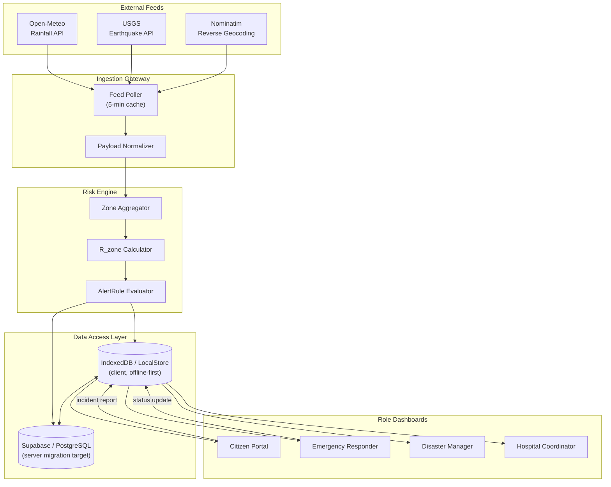
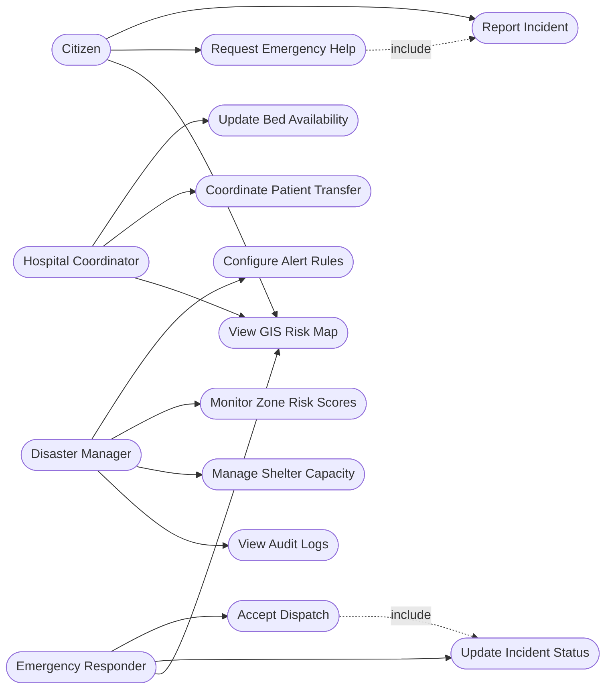
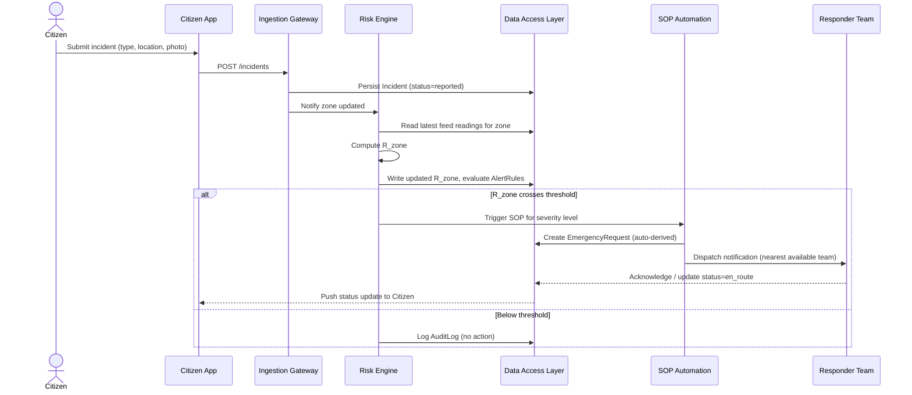
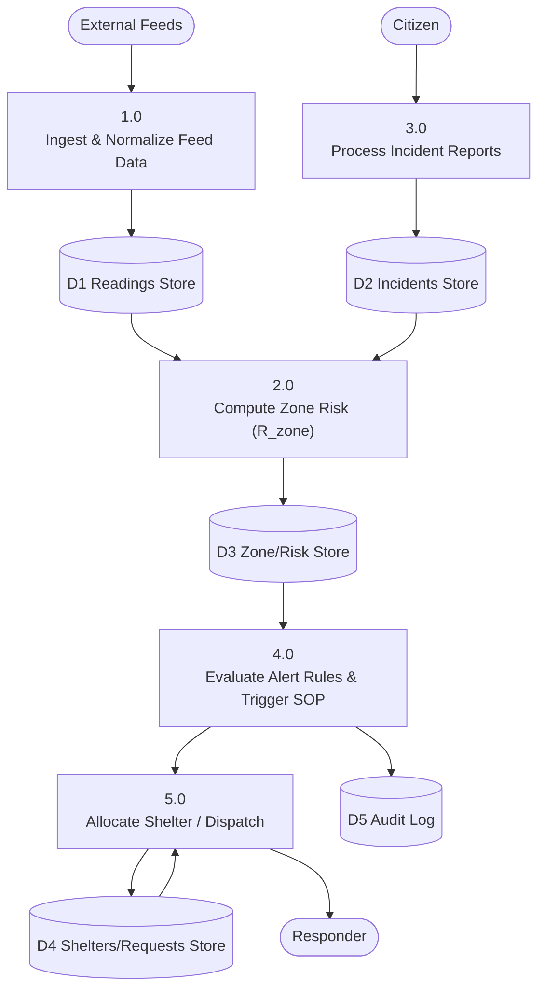

# DisasterOS — System & UML Diagrams (Mermaid Format)

Import these into Draw.io (Arrange → Insert → Advanced → Mermaid) to export vector PNG/SVG diagrams for your Springer paper.

---

## 1. High-Level System Architecture

---

## 2. UML Use Case Diagram

---

## 3. UML Sequence Diagram

---

## 4. Data Flow Diagram (Level 1)

