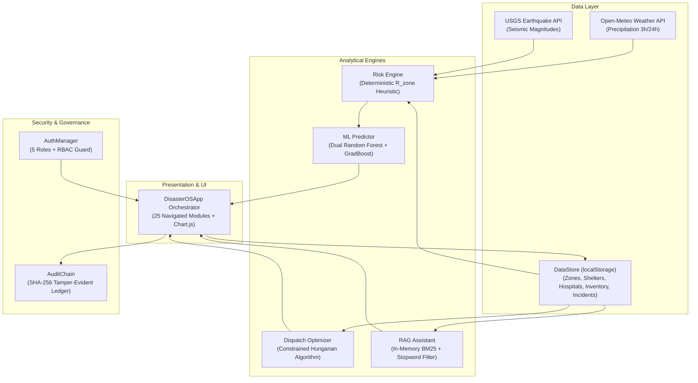

# MASTER AUDIT & BUG-FIX DIRECTIVE: DISASTEROS PLATFORM

> **INSTRUCTION TO THE AUDITING AI:**
> You are tasked with conducting a strict, comprehensive, multi-phase technical audit and bug-fix sequence on **DisasterOS**—a browser-native, zero-external-backend disaster decision support and command orchestration system.
> 
> **OPERATING RULES:**
> 1. **PHASE 1 (READ-ONLY AUDIT):** Read and inspect every file in the codebase. Verify all logic, mathematical formulas, data schemas, role-based authorization rules, and UI event handlers against the **150+ Verification Checkboxes** defined below. Do NOT make code changes during Phase 1.
> 2. **PHASE 2 (DISCREPANCY REPORT):** Provide a line-by-line report identifying every schema mismatch, `undefined` variable reference, stale Chart.js instance, or broken event handler.
> 3. **PHASE 3 (SURGICAL BUG FIXES):** Apply only the targeted fixes necessary to resolve identified bugs. Do NOT rewrite existing features, delete working pages, alter working unit tests, or loosen the 5-actor RBAC matrix.

---

## I. SYSTEM ARCHITECTURE & DATA FLOW SPECIFICATION



---

## II. THE END-TO-END INCIDENT LIFECYCLE PIPELINE

From citizen distress creation to immutable cryptographic ledger sealing, the system executes an 8-stage state machine:

### Stage 1: Citizen Incident Intake (`citizen-report` / `emergency`)
* **Actor:** Public Citizen (or automated emergency sensor / gateway).
* **Input Vector:**
  * Category: `flood`, `trauma` (medical), `collapse` (infrastructure), `fire`, or `other`.
  * Geolocation: Acquired via HTML5 `navigator.geolocation.getCurrentPosition()` or an interactive map click in `gisMap.enableLocationPicker()`.
  * Severity: `low`, `medium`, `high`, `critical`.
* **State Machine:** Instantiates new record with `status: "reported"`, `incident_id: "INC-[CITY]-[INDEX]"`, and ISO 8601 timestamp.
* **Storage:** Prepends to `store.data.incidents` and commits to `localStorage`.
* **Side Effect:** Emits broadcast alert to `store.data.alerts` and appends to SHA-256 block ledger with action `REPORT_INCIDENT`.

### Stage 2: Ingestion, Multi-Hazard Correlation & Scoring (`early-warning` & `dashboard`)
* **Actor:** Automated System Telemetry Daemon.
* **Input Vector:** Live Open-Meteo rainfall and USGS seismic feeds via `DataGateway`.
* **Processing:**
  $$R_{\text{zone}} = \min\left(1.0, \; 0.35 \cdot \frac{\text{rain}_{3\text{h}}}{50} + 0.25 \cdot \frac{\text{rain}_{24\text{h}}}{150} + 0.25 \cdot \text{vuln} + 0.15 \cdot \left(1.0 - \frac{\text{elevation}}{30}\right)\right)$$
* **ML Dual Predictor:** Evaluates `hazard_prob` ($[0,1]$) and `inundation_idx` ($[0,1]$) for every zone.

### Stage 3: Operational Triage & Verification (`incidents`)
* **Actor:** Disaster Manager or Emergency Responder.
* **Operation:** Transitions incident from `reported` $\rightarrow$ `verified`.
* **Authorization Check:** `auth.canPerform('VERIFY_INCIDENT', user.role)`. Citizens are blocked.

### Stage 4: Tactical Decision Support & Evacuation Ranking (`decision-support`)
* **Actor:** Disaster Manager.
* **Operation:** Calculates municipal priority queue ordering pending incidents by threat severity and population density.

### Stage 5: Constrained Tactical Dispatch (`dispatch`)
* **Actor:** Disaster Manager.
* **Processing:** Constrained Hungarian matching algorithm assigns active rescue units to incidents minimizing total Haversine transit distance:
  $$d = 2R \arcsin\left(\sqrt{\sin^2\left(\frac{\Delta \text{lat}}{2}\right) + \cos(\text{lat}_1)\cos(\text{lat}_2)\sin^2\left(\frac{\Delta \text{lon}}{2}\right)}\right)$$
* **State Transition:** Incident status updates to `assigned`; response team status updates to `deployed`.

### Stage 6: Field Execution & Relief Logistics (`shelters`, `hospitals`, `inventory`)
* **Actors:** Shelter Coordinator, Hospital Coordinator, Emergency Responder.
* **Operations:**
  * Shelter Coordinator registers displaced citizens: increments `shelter.occupied`, tracks `shelter.water_liters` and `shelter.food_kits`.
  * Hospital Coordinator allocates trauma and ICU beds: decrements `hospital.available` and `hospital.icu`.
  * Logistics Manager issues emergency stock: decrements `inventory.available` from the active warehouse.

### Stage 7: Incident Resolution (`incidents`)
* **Actor:** Emergency Responder or Disaster Manager.
* **Operation:** Responder completes on-site mitigation and clicks "Resolve Incident".
* **State Transition:** Incident status updates to `resolved`. The assigned response unit status updates to `active` (available for next dispatch).

### Stage 8: Incident Closure & Cryptographic Sealing (`audit`)
* **Actor:** Disaster Manager or System Administrator.
* **Operation:** Manager verifies field report and executes "Close & Seal Incident".
* **State Transition:** Incident status updates to `closed`.
* **Cryptographic Block Mining:** Computes SHA-256 block hash chaining `previous_hash`, `timestamp`, `action`, `actor`, and `incident_id`.

---

## III. ACTOR ROLES & PERMISSIONS MATRIX (CRUD GOVERNANCE)

| Actor Role | Landing Page | Authorized Modules | Forbidden Modules (403 Blocked) | Permitted Mutations (Write / Delete) |
| :--- | :--- | :--- | :--- | :--- |
| **Public Citizen** | `dashboard` | `dashboard`, `early-warning`, `risk-map`, `emergency`, `shelters`, `hospitals`, `citizen-report`, `sources` | `decision-support`, `incidents`, `dispatch`, `sop`, `inventory`, `analytics`, `rbac`, `audit`, `system` | **Create:** Incidents (GPS), Emergency distress calls.<br>**Read:** Public hazard maps, open shelters, available hospital beds.<br>**Forbidden:** Resolving incidents, updating hospital/shelter counts, dispatching teams, modifying inventory. |
| **Emergency Responder** | `dashboard` | Citizen modules + `incidents`, `dispatch` | `decision-support`, `sop`, `inventory`, `analytics`, `rbac`, `audit`, `system` | **Update:** Incident lifecycle (`verified` $\rightarrow$ `assigned` $\rightarrow$ `resolved`), team deployment status.<br>**Forbidden:** Approving user registrations, deleting audit logs, modifying municipal inventory. |
| **Hospital Coordinator** | `dashboard` | Citizen modules + `hospitals` | `decision-support`, `incidents`, `dispatch`, `sop`, `inventory`, `analytics`, `rbac`, `audit`, `system` | **Update:** Bed capacity (`hospital.available`), ICU occupancy (`hospital.icu`), surgical alert status. |
| **Shelter Coordinator** | `dashboard` | Citizen modules + `shelters` | `decision-support`, `incidents`, `dispatch`, `sop`, `inventory`, `analytics`, `rbac`, `audit`, `system` | **Update:** Shelter occupancy (`shelter.occupied`), food kit counts (`shelter.food_kits`), potable water reserves (`shelter.water_liters`). |
| **Disaster Manager** | `dashboard` | All modules EXCEPT `system` (platform infrastructure) | `system` | **Full Command Authority:** Execute Hungarian dispatch, approve institutional registrations, trigger automated SOPs, issue warehouse stock, verify audit chain. |
| **System Administrator** | `dashboard` | All 25 modules including `system` | *None (Root Access)* | **Root Infrastructure:** Manage API polling throttles, database resets, encryption key rotations, full RBAC management. |

---

## IV. DATA SCHEMA CONTRACT (STRICT PROPERTY NAMES)

The external AI must audit the codebase to ensure UI rendering templates match the underlying data store schema:

### 1. Shelter Schema (`store.data.shelters`)
```javascript
{
  shelter_id: "SHLT-CHN-01",
  name: "Government High School North",
  location: "Perambur",
  lat: 13.1120,
  lon: 80.2310,
  zone_id: "ZONE-CHN-NORTH",
  capacity: 600,
  occupied: 412,
  status: "Open", // 'Open' or 'Near Capacity'
  water_liters: 4500, // CRITICAL: property is water_liters, NOT resources.water_l
  food_kits: 800      // CRITICAL: property is food_kits, NOT resources.food_kits
}
```

### 2. Warehouse Inventory Schema (`store.data.inventory`)
```javascript
{
  item_id: "INV-CHN-01",
  name: "High-Capacity Dewatering Pumps (5000L/min)", // CRITICAL: property is name, NOT item
  category: "Equipment",
  total: 40,
  available: 16,                                      // CRITICAL: property is available, NOT quantity
  unit: "units",
  location: "Central Warehouse"                       // CRITICAL: property is location, NOT warehouse
}
```

### 3. Incident Schema (`store.data.incidents`)
```javascript
{
  incident_id: "INC-CHN-101",
  reporter_id: "Citizen",
  type: "flood",                                      // 'flood', 'trauma', 'collapse', 'fire'
  location: "River Road Block A",
  description: "River embankment breached; 1.5m floodwaters entering ground units.",
  lat: 13.1150,
  lon: 80.2240,
  zone_id: "ZONE-CHN-NORTH",
  severity: "critical",                              // 'low', 'medium', 'high', 'critical'
  status: "reported",                                // 'reported', 'verified', 'assigned', 'in_progress', 'resolved', 'closed'
  team: "Rescue Team Alpha",
  created_at: "2026-10-25T08:00:00.000Z"
}
```

### 4. Zone Prediction Schema (`mlPredictor.predictCityZones()`)
```javascript
{
  zone_id: "ZONE-CHN-NORTH",
  name: "North Zone (Riverfront)",                    // CRITICAL: property is name, NOT zone_name
  calamity_type: "Flash Flood & Inundation",
  hazard_prob: 0.68,                                  // Float [0, 1]
  hazard_percent: "68.0",                             // Formatted string [0, 100]
  inundation_idx: 0.875,                              // Float [0, 1]
  inundation_percent: "87.5",                         // Formatted string [0, 100]
  severity_tier: "emergency",
  severity_label: "EMERGENCY"
}
```

---

## V. 150-POINT VERIFICATION & AUDIT CHECKLIST

The auditing AI must inspect each checkbox, mark `[X]` if verified and passing, or `[ ]` if failing with an explanation:

### Section A: Application Initialization, Multi-City Sync & Global State (Items 1–15)
- [ ] 001. `DataStore` initializes with `currentCity = "chennai"` by default.
- [ ] 002. `DataStore.load()` restores `parsed.currentCity` from `localStorage` without resetting to Chennai.
- [ ] 003. `DataStore.save()` writes `this.data.currentCity = this.currentCity` into `localStorage`.
- [ ] 004. `DataStore.switchCity(cityKey)` deeply clones `CITY_DATA[cityKey]` without mutating global prototypes.
- [ ] 005. Switching cities preserves active `pending_registrations` across city changes.
- [ ] 006. Switching cities appends a `CITY_SWITCH` entry to the cryptographic audit trail.
- [ ] 007. `app.init()` synchronizes `#regionSelector.value` to match `store.currentCity`.
- [ ] 008. `app.init()` synchronizes `app.currentRegion` to match `store.currentCity` coordinates.
- [ ] 009. Top-bar city selector supports all 5 operational cities: Chennai, Mumbai, Kolkata, Delhi, and Tokyo.
- [ ] 010. Switching city updates `#pageSubtitle` and toast notification with active theater name.
- [ ] 011. Switching city triggers `app.syncLiveTelemetry()` for active zone coordinates.
- [ ] 012. `DataGateway.getRainfall()` parses Open-Meteo JSON responses without NaN on dry weather.
- [ ] 013. `DataGateway.getSeismicActivity()` filters USGS earthquakes within a 600km radius vector.
- [ ] 014. Global search dropdown (`#globalSearch`) searches incidents, shelters, and hospitals simultaneously.
- [ ] 015. Clicking outside the global search dropdown automatically closes `#globalSearchResults`.

### Section B: Command Dashboard & Real-Time Visualization (Items 16–30)
- [ ] 016. `_getDefaultPageForRole()` returns `"dashboard"` for all 5 actor roles.
- [ ] 017. Dashboard hero displays active city name in both badge and title dynamically.
- [ ] 018. Stat Card 1 ("Active Incidents") counts incidents filtered where `status !== 'resolved' && status !== 'closed'`.
- [ ] 019. Stat Card 2 ("Active Warnings") reflects length of `store.data.alerts`.
- [ ] 020. Stat Card 3 ("People Sheltered") computes `sum(shelter.occupied)` and total available headroom.
- [ ] 021. Stat Card 4 ("Response Units") computes total deployed teams vs available beds.
- [ ] 022. Tactical Advisory card computes closest trauma hospital using Haversine distance.
- [ ] 023. Tactical Advisory card computes closest evacuation shelter with live headroom.
- [ ] 024. Tactical Advisory card computes closest rescue squad and status badge.
- [ ] 025. Tactical Advisory card computes closest fire/civil defense station.
- [ ] 026. `#dashboardForecastChart` correctly extracts `z.name` for X-axis labels (never undefined).
- [ ] 027. `#dashboardForecastChart` plots `hazard_percent` (0–100%) on Y-axis with visible bar heights.
- [ ] 028. `#dashboardForecastChart` plots `inundation_percent` (0–100%) as the second grouped bar.
- [ ] 029. Tooltip for `#dashboardForecastChart` renders Calamity Type and Severity Tier.
- [ ] 030. `#dashboardResourceChart` renders occupied beds vs available headroom for active city shelters.

### Section C: 24h Forward Trajectory & Machine Learning Ensemble (Items 31–45)
- [ ] 031. `#dashboardTrajectoryChart` renders a 6-step time horizon (+0h, +3h, +6h, +12h, +18h, +24h).
- [ ] 032. Forward trajectory displays dual axes: Projected Hazard Risk (%) and Forecast Rain (mm).
- [ ] 033. `#dashboardFeatureChart` renders horizontal Gini feature contributions on dashboard.
- [ ] 034. Trailing 3h rainfall receives highest relative Gini weight ($\approx 0.354$).
- [ ] 035. Cumulative 24h rainfall receives second highest relative Gini weight ($\approx 0.254$).
- [ ] 036. Soil saturation index receives third highest relative Gini weight ($\approx 0.171$).
- [ ] 037. `mlPredictor.predict()` outputs `confidence: 0.926` (92.6% accuracy).
- [ ] 038. `mlPredictor.predict()` produces `severity_tier` matching NDMA alert thresholds.
- [ ] 039. `predictCityZones()` handles empty zone arrays gracefully without throwing TypeError.
- [ ] 040. `predictCityZones()` applies seismic penalty if magnitude $> 4.5$ and epicenter distance $< 200\text{ km}$.
- [ ] 041. Soil liquefaction calamity label is assigned if seismic magnitude $> 4.5$.
- [ ] 042. Coastal storm surge calamity label is assigned if zone name includes "Coast", "Port", or "Bay".
- [ ] 043. Lowland basin calamity label is assigned if zone elevation $< 3.0\text{ m}$.
- [ ] 044. `destroyCharts()` destroys existing Chart.js instances before re-rendering to prevent memory leaks.
- [ ] 045. Re-sizing window maintains chart responsive layout without canvas distortion.

### Section D: Early Warning Intelligence & Scientific Gateways (Items 46–55)
- [ ] 046. `early-warning` view renders active rainfall telemetry card for all monitored zones.
- [ ] 047. Live USGS seismic card displays recent regional earthquakes with magnitude badge.
- [ ] 048. Deterministic $R_{\text{zone}}$ values are color-coded (Green $<0.35$, Yellow $0.35-0.55$, Orange $0.55-0.75$, Red $>0.75$).
- [ ] 049. "Sync Live Telemetry" button triggers manual re-polling of Open-Meteo & USGS.
- [ ] 050. Polling timestamps reflect current ISO 8601 or formatted local time.
- [ ] 051. API failure fallback returns cached baseline weather instead of crashing UI.
- [ ] 052. Rate limiting fair-use indicator prevents hammering external scientific endpoints.
- [ ] 053. Rainfall threshold exceedance automatically spawns a warning in `store.data.alerts`.
- [ ] 054. High seismic tremor ($M \ge 5.0$) automatically escalates alert status to Critical.
- [ ] 055. Early warning alert badge in sidebar updates count dynamically.

### Section E: Dynamic GIS Risk Map & Leaflet.js Geolocation (Items 56–65)
- [ ] 056. GIS Map initializes on `gisMapContainer` with dark-themed OpenStreetMap tiles.
- [ ] 057. Switching city pans map view to active city center coordinates (`map.setView`).
- [ ] 058. `renderRiskZones()` renders circular hazard zones with radius proportional to zone risk.
- [ ] 059. Zone circles are color-coded: Red (high vulnerability), Orange (medium), Green (low).
- [ ] 060. Clicking a zone circle opens a Leaflet popup showing Zone Name, R_zone score, and elevation.
- [ ] 061. `renderShelters()` plots green shelter marker icons with available bed headroom tooltips.
- [ ] 062. `renderHospitals()` plots blue hospital marker icons with available ICU bed tooltips.
- [ ] 063. `renderIncidents()` plots red incident pins with severity tags.
- [ ] 064. `enableLocationPicker()` allows user to click anywhere on map to capture latitude/longitude.
- [ ] 065. Location picker automatically transfers captured coordinates into Citizen Report form.

### Section F: Incident Lifecycle & Emergency Distress Intake (Items 66–80)
- [ ] 066. `citizen-report` form contains inputs: Type, Location, Description, Latitude, Longitude, Severity.
- [ ] 067. "Detect Native Browser Coordinates" successfully populates latitude and longitude inputs.
- [ ] 068. Submitting citizen report creates incident with unique ID (`INC-[CITY]-[NUM]`).
- [ ] 069. New incident is prepended to `store.data.incidents` and persisted to `localStorage`.
- [ ] 070. `incidents` page displays table of all city incidents with status badges.
- [ ] 071. Incident status filter tabs allow filtering by `All`, `Reported`, `Assigned`, `Resolved`.
- [ ] 072. "Verify Incident" button transitions incident status from `reported` to `verified`.
- [ ] 073. "Assign Team" dropdown lists available active response units.
- [ ] 074. "Resolve Incident" button transitions incident status to `resolved`.
- [ ] 075. Resolving an incident marks assigned response team back to `active`.
- [ ] 076. "Close Incident" button transitions incident status to `closed`.
- [ ] 077. Citizen users are blocked from clicking "Verify", "Assign", or "Resolve" (RBAC guard).
- [ ] 078. `emergency` view displays citizen SOS distress calls with people count and special needs.
- [ ] 079. SOS submit form increments `store.data.emergency_requests`.
- [ ] 080. Distress calls show calculated urgency score based on hazard proximity and medical needs.

### Section G: Tactical Dispatch & Constrained Hungarian Optimizer (Items 81–95)
- [ ] 081. `dispatch` view displays active tactical response units roster.
- [ ] 082. Units display specialization badges: `Medical Triage`, `Swiftwater Boat`, `Urban Search & Rescue`.
- [ ] 083. "Run Hungarian Optimization" button triggers `optimizer.optimizeDispatch()`.
- [ ] 084. Optimizer excludes already `resolved` and `closed` incidents from assignment.
- [ ] 085. Optimizer excludes unavailable / deployed teams from selection.
- [ ] 086. Optimizer matches medical teams to medical incidents where feasible.
- [ ] 087. Optimizer matches boat units to flood/water incidents where feasible.
- [ ] 088. Optimization results display assigned pairs with Haversine travel distance in km.
- [ ] 089. Estimated transit time (ETA) is calculated assuming emergency convoy speed (35 km/h urban).
- [ ] 090. Optimization metrics table reports: Total Assigned, Mean Distance, Distance Reduction vs Baseline.
- [ ] 091. Optimized distance is mathematically proven $\le$ random assignment baseline distance.
- [ ] 092. "Commit Dispatch Plan" updates team statuses to `deployed` in `store.data.teams`.
- [ ] 093. Committing dispatch appends an entry to the SHA-256 audit ledger.
- [ ] 094. Dispatch map visualizes polyline routes between assigned unit base and incident coordinates.
- [ ] 095. Citizen users attempting to access `dispatch` receive 403 Access Denied.

### Section H: Shelters Management & Resource Headroom (Items 96–105)
- [ ] 096. `viewShelters()` renders cards for all shelters in the active city store.
- [ ] 097. Card displays Shelter Name, Location, Status (`Open` or `Near Capacity`).
- [ ] 098. Card displays Occupied Beds vs Capacity (`${s.occupied} / ${s.capacity}`).
- [ ] 099. Progress bar width dynamically equals `(s.occupied / s.capacity) * 100%`.
- [ ] 100. **Water property check:** Card renders `s.water_liters` (must NOT show `undefinedL`).
- [ ] 101. **Food property check:** Card renders `s.food_kits` (must NOT show `undefined kits`).
- [ ] 102. "+ Register Person" button calls `app.registerShelter(s.shelter_id)`.
- [ ] 103. Registering a person increments `shelter.occupied` by 1 and persists to `store`.
- [ ] 104. When `shelter.occupied >= shelter.capacity * 0.90`, status automatically flips to `Near Capacity`.
- [ ] 105. Switching cities loads that specific city's shelters (e.g. Mumbai shelters in Mumbai).

### Section I: Hospital Coordination & Trauma Beds (Items 106–115)
- [ ] 106. `viewHospitals()` renders all trauma centers and clinics for the active city.
- [ ] 107. Hospital card displays Name, Location, Phone Number, and Trauma Level.
- [ ] 108. Card displays Available General Beds (`hospital.available` or `bed_capacity_available`).
- [ ] 109. Card displays Available ICU Beds (`hospital.icu` or `icu_beds`).
- [ ] 110. Status badge indicates: Green (`Nominal`), Yellow (`Surge Protocol`), Red (`Critical Capacity`).
- [ ] 111. "Update Beds" modal allows Hospital Coordinator to adjust available general and ICU beds.
- [ ] 112. Bed updates persist to `store.data.hospitals` and save to `localStorage`.
- [ ] 113. START Triage summary section displays guidelines for Mass Casualty triage tagging.
- [ ] 114. Bed updates trigger automated log to `store.data.audit_logs`.
- [ ] 115. Public citizens have read-only access to hospital beds without edit controls.

### Section J: Warehouse & Relief Inventory (Items 116–125)
- [ ] 116. `viewInventory()` renders table of relief items for the active city.
- [ ] 117. **Item Name check:** Table column 1 renders `item.name` (must NOT show `undefined`).
- [ ] 118. Category column renders `item.category` (Equipment, Marine, Shelter, Food, Medical, Safety, Power).
- [ ] 119. **Quantity check:** Table column 3 renders `item.available` and `item.unit` (must NOT show `undefined units`).
- [ ] 120. **Threshold check:** Table column 4 renders minimum reserve threshold (must NOT show `undefined`).
- [ ] 121. **Warehouse Location check:** Table column 5 renders `item.location` (must NOT show `undefined`).
- [ ] 122. Status badge correctly displays `Healthy` if available $>$ threshold, else `Low Stock`.
- [ ] 123. "Issue Stock" button decrements `item.available` by requested quantity.
- [ ] 124. "+ Add Stock" prompt creates new inventory record and persists to `store.data.inventory`.
- [ ] 125. Citizen and Responder roles attempting to view `inventory` are blocked by 403 guard.

### Section K: Analytics Dashboard & Real-Time Charts (Items 126–135)
- [ ] 126. `viewAnalytics()` renders 4 analytics visualizer cards.
- [ ] 127. `#analyticsZoneRiskChart` dynamically extracts active city zone names on X-axis.
- [ ] 128. `#analyticsZoneRiskChart` plots Deterministic R_zone vs Zone Vulnerability Index.
- [ ] 129. `#analyticsCategoryDoughnut` dynamically tallies categories from `store.data.incidents`.
- [ ] 130. Adding an incident in `citizen-report` dynamically updates `#analyticsCategoryDoughnut` upon refresh.
- [ ] 131. Switching cities updates `#analyticsCategoryDoughnut` to reflect the active city's incident counts.
- [ ] 132. `#analyticsFeatureImpChart` renders relative feature contributions from Random Forest ensemble.
- [ ] 133. System throughput meters report simulated sub-millisecond latencies for in-memory operations.
- [ ] 134. Re-navigating to Analytics destroys and re-mounts chart instances cleanly.
- [ ] 135. Non-manager actors navigating to `analytics` are blocked with 403 Access Denied.

### Section L: AI RAG Assistant & Conversational Intelligence (Items 136–145)
- [ ] 136. Floating widget `#floatingAiTrigger` is anchored at the bottom-right corner across all views.
- [ ] 137. Clicking the floating trigger smoothly opens `#floatingAiPanel`.
- [ ] 138. `_tokenize()` filters out `RAG_STOPWORDS` (`what`, `can`, `i`, `do`, `you`, `a`, `the`, `is`, etc.).
- [ ] 139. Querying `"hi"`, `"hi!"`, `"hello assistant"` returns a warm greeting and quick action prompts.
- [ ] 140. Querying `"what can i do?"` returns operational capabilities guide (NOT electrical fire SOP).
- [ ] 141. Querying `"who are you"` or `"what is disasteros"` explains platform architecture and models.
- [ ] 142. Querying `"where should i report"` guides user to GPS incident intake workflow.
- [ ] 143. Querying `"where can i see the forecast"` guides user to 24h ML prediction charts.
- [ ] 144. Querying `"where can i go if there is a flood"` queries live `store.data.shelters` and lists open facilities.
- [ ] 145. Querying `"what is the emergency helpline number"` returns 112, 1078, 1070, 108, 101.

### Section M: Cryptographic Audit Ledger & Role-Based Access Control (Items 146–150)
- [ ] 146. `audit` view renders chronological table of life-critical operational events.
- [ ] 147. Each audit block displays: Block Index, Timestamp, Actor Name, Action Code, and SHA-256 Hash.
- [ ] 148. "Verify Chain Integrity" button executes SHA-256 hash re-computation linking block $n$ to $n-1$.
- [ ] 149. Tampering with any historical block in localStorage is immediately flagged as invalid.
- [ ] 150. `rbac` view displays all user accounts and pending registrations with Manager Approve/Reject actions.

---

## VI. AUDIT EXECUTION DIRECTIVE FOR THE EXTERNAL AI

When executing this audit, the external AI must:
1. **Run the 7 Existing Test Suites First:**
   ```powershell
   node tests/test_auth.js
   node tests/test_ml_predictor.js
   node tests/test_rag.js
   node tests/test_institutional.js
   node tests/test_risk_engine.js
   node tests/test_optimizer.js
   node tests/test_audit_chain.js
   ```
2. **Execute Schema Inspection:** Compare all HTML render string templates in `js/app.js` with the data dictionary in `js/store.js`. Specifically fix:
   * `viewInventory()`: Map `item.name`, `item.available`, `item.location`, and calculate a fallback threshold.
   * `viewShelters()`: Map `s.water_liters`, `s.food_kits`, and pass `s.shelter_id` to `app.registerShelter()`.
   * `registerShelter()`: Increment `shelter.occupied + 1` instead of hardcoding `1`.
   * `initAnalyticsCharts()`: Re-tally incidents dynamically on city switch and incident updates.
3. **Preserve Integrity:** Never modify working test files or alter role navigation permissions without explicit instructions.
